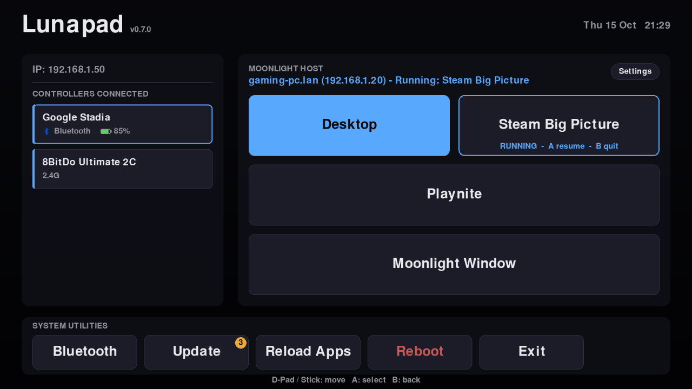
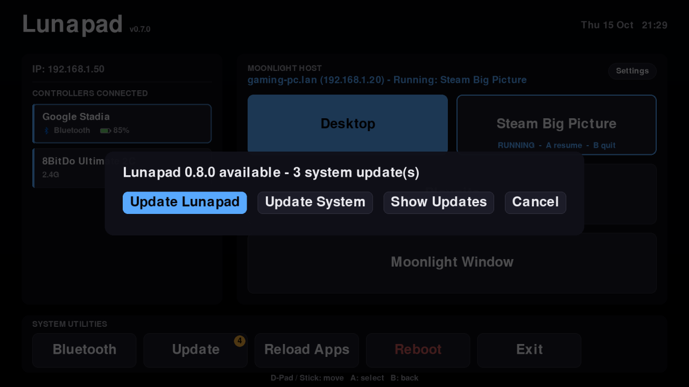
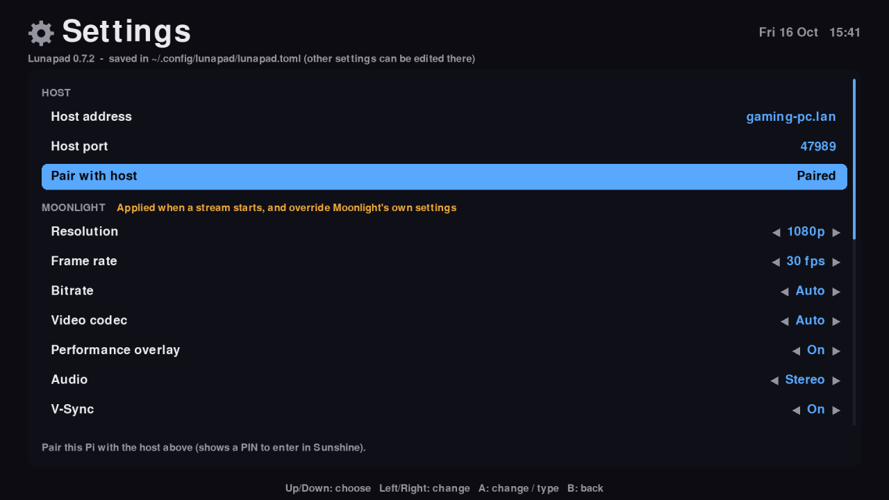
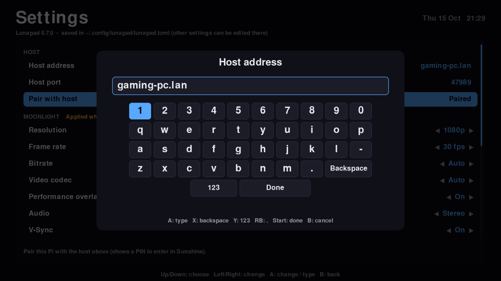
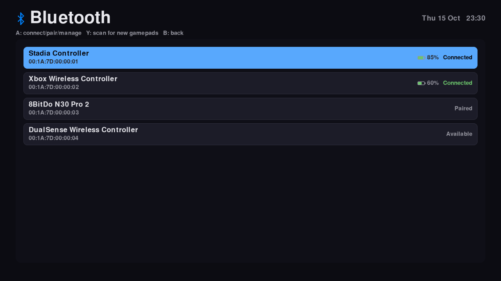

# Lunapad

A gamepad-only launcher that turns a Raspberry Pi 4 into a TV box for streaming PC games (Moonlight client → Sunshine host). No keyboard or mouse needed.



> **This project was vibecoded** - I want to be upfront that a lot of
> this was built through conversation with an AI assistant (Claude).
> I understand people have mixed feelings about AI-assisted code, and
> generally agree with those feelings. But for a personal, one-off
> homelab project like this - something you just want to get up and
> running - I think it's a genuinely great tool to have at my
> disposal.
>
> I have taken great care to review & understand all code changes
> made by AI tools within this project.

## Features

- **Dashboard** — one tile per app on the host (from `moonlight-qt list`, cached for when the host is off), plus connected controllers with Bluetooth and battery status
- **Bluetooth page** — list, scan for, pair, connect, disconnect and forget gamepads
- **Update** — updates Lunapad itself from GitHub (the **Stable** or **Beta** channel, chosen in Settings → Updates), and the Pi's apt packages, with live output. After a system update it offers to remove packages no longer needed (old kernels), showing the list first
- **Reload Apps** — re-read the host's app list now, instead of waiting for the 10-minute auto-refresh
- **Settings** — the Settings chip in the host panel opens a gamepad settings page: host address, stream resolution / fps / bitrate / codec / audio / overlay and other stream options, the launcher's screen resolution, and idle timings. Everything is saved in the `lunapad` account's `~/.config/lunapad/lunapad.toml`
- **Moonlight check** — if Moonlight Qt isn't installed, the host panel says so and launching explains how to install it (Lunapad never installs it). An install older than 6.2.0 gets a warning, since new host apps only appear from 6.2.0
- **Pairing** — if the Pi isn't paired with the host, the host line says so; pressing A on an app, or **Settings > Pair with host**, shows a PIN to enter in Sunshine's web page (PIN tab) and pairs without opening Moonlight
- **Running sessions** — if an app is still running on the host (e.g. you left a stream without quitting), the host line and its tile say so. A resumes it (or quits it), B quits it, and launching a different app offers to close it first
- **Idle dim** — after 5 minutes idle the screen dims, and after 5 more it fades to black (burn-in protection; both times are in Settings). The first input wakes it without triggering an action

## Screenshots

| Update: Lunapad and the Pi's packages | Settings, from the gamepad |
|---|---|
|  |  |
| **On-screen keyboard** (full keyboard / number pad) | **Bluetooth gamepads** |
|  |  |

These are rendered from Lunapad's own drawing code with sample data (`tools/readme_screenshots.py`).

## Installation

Tested on a **Raspberry Pi 4** with **Raspberry Pi OS Lite (Debian 13 "trixie")**, streaming from a Windows PC running **Sunshine**.

Lunapad runs as its own `lunapad` account, which logs in automatically on the TV and can reboot and run updates, nothing else. Your own account is only needed for installing and maintenance.

| What | Where on the Pi |
|---|---|
| Program and images | `/opt/lunapad/` (a git checkout, owned by root) |
| Settings | `/home/lunapad/.config/lunapad/lunapad.toml` |
| Cache | `/home/lunapad/.cache/lunapad/` |
| Moonlight's pairing | `/home/lunapad/.config/Moonlight Game Streaming Project/` |

### 1. The gaming PC

Install and set up [Sunshine](https://docs.lizardbyte.dev/projects/sunshine/) on the PC you stream from. Note its IP address or hostname.

### 2. The Pi: Raspberry Pi OS Lite

Install **Raspberry Pi OS Lite** (no desktop needed), create your admin account, and connect the Pi to your network.

### 3. The Pi: Moonlight Qt 6.2.0 or newer

Lunapad uses Moonlight Qt to stream, list the host's apps and pair, but never installs it itself. These are the commands from Moonlight's [Raspberry Pi guide](https://github.com/moonlight-stream/moonlight-docs/wiki/Installing-Moonlight-Qt-on-Raspberry-Pi-4):

```sh
curl -1sLf 'https://dl.cloudsmith.io/public/moonlight-game-streaming/moonlight-qt/setup.deb.sh' | distro=raspbian codename=$(lsb_release -cs) sudo -E bash
sudo apt install moonlight-qt
```

Check the version with `moonlight-qt --version`. You need **6.2.0 or newer**: older versions' `moonlight-qt list` prints a stale cached app list that only updates when the Moonlight GUI runs, and the dashboard warns about it.

### 4. Install Lunapad

On the Pi (over SSH, or with a keyboard plugged in), as your admin account:

```sh
curl -fsSL https://raw.githubusercontent.com/NSF12345/lunapad/main/install.sh | sudo bash
```

That downloads the installer and runs it as root. It fetches the repo into a temporary folder, installs the **latest release**, and cleans up after itself.

**Or clone it yourself**, to read `install.sh` before running it:

```sh
sudo apt-get install -y git
git clone https://github.com/NSF12345/lunapad.git
less lunapad/install.sh        # optional: read it first
sudo ./lunapad/install.sh
rm -rf lunapad                 # the installed copy lives in /opt/lunapad
```

Either way, the installer:
- installs the packages it needs (`python3-pygame`, `fbi`, `bluez`, `git`)
- creates the `lunapad` account
- puts the latest release in `/opt/lunapad`
- sets up its login loop, sudo rules and console autologin
- starts it on the TV

To preset the gaming PC and skip the first-run host setup, add `LUNAPAD_HOST`: `... | sudo LUNAPAD_HOST=<pc> bash`, or `sudo LUNAPAD_HOST=<pc> ./lunapad/install.sh`.

It's safe to run again; that repairs the install. Later, without a clone: `sudo /opt/lunapad/install.sh`.

### 5. First start

1. The TV shows the splash, then the dashboard.
2. The dashboard shows **Set up host**. Press A and type the gaming PC's hostname or IP with the on-screen keyboard. **123** / **ABC** (or Y) switches between the number pad and the full keyboard, and RB types a `.`. Lunapad restarts with it. (To skip this, set it at install time with `LUNAPAD_HOST`; see step 4.) You can change it later in **Settings** → **Host address**.
3. The dashboard shows **Pair with Sunshine**. Press A, then enter the PIN shown on the TV in Sunshine's web page (`https://<pc>:47990` → **PIN**).
4. Your PC's apps appear as tiles. Pick one and play.

The Settings page shows the installed version at the top.

### Updating

Lunapad updates itself: when a new release is out, the **Update** button shows a badge and offers **Update Lunapad**. It follows the **Stable** channel (release tags) by default. Switch to **Beta** in **Settings** → **Updates** to get changes before they're released.

### Installing from a PC (development)

From a PC with this repo, in Git Bash, `deploy/install-on-pi.sh` sends the repo's committed history to the Pi and runs `install.sh` there. Give the Pi as `PI=user@host`, or save `user@host` once in `deploy/pi-target` (git-ignored). It asks for the Pi password for the upload and the session, then for `sudo`.

```sh
bash deploy/install-on-pi.sh
LUNAPAD_REF=<branch or commit> bash deploy/install-on-pi.sh   # something other than the latest release
```

`deploy/deploy.sh` copies uncommitted changes straight into `/opt/lunapad` for quick testing.

### Uninstalling

```sh
sudo /opt/lunapad/uninstall.sh              # everything, including settings and Moonlight pairing
sudo /opt/lunapad/uninstall.sh --keep-data  # keep the lunapad account and its data for a reinstall
```

It removes:
- the console autologin as `lunapad` (the TV goes back to a login prompt)
- the sudo and apt files
- `/opt/lunapad`
- the `lunapad` account, unless `--keep-data`

It asks first; add `--yes` to skip that. The apt packages `install.sh` added and Moonlight Qt are left installed.

## Layout

On the Pi, the program lives in `/opt/lunapad/` and runs as the `lunapad` account, with its settings and cache in that account's `~/.config/lunapad/` and `~/.cache/lunapad/` (see Installation). Paths come from the program's folder and the account's home, so nothing is hard-coded.

| Path | Purpose |
|---|---|
| `lunapad.py` | The launcher (pygame, `SDL_VIDEODRIVER=kmsdrm`). Version in `__version__`; `deploy.sh` adds the git commit as `BUILD` |
| `settings.py` | Every setting: label, allowed values, default and help. Drives both `~/.config/lunapad/lunapad.toml` and the Settings page |
| `~/.config/lunapad/lunapad.toml` (on the Pi, not in the repo) | Your settings, created with defaults on first run and documented line by line. Edit by hand or from the Settings page |
| `bluetooth_icon.png`, `splash.png` | UI assets |
| `install.sh` | The installer, run as root on the Pi: packages, the `lunapad` account, `/opt/lunapad`, login loop, sudo rules, autologin. Safe to re-run |
| `deploy/self-update.sh` | Run by the Update screen (as root, via the sudo rule): fetches the newest stable release tag or the beta branch from GitHub, checks it out and runs `install.sh --update` |
| `uninstall.sh` | Removes everything `install.sh` set up (`--keep-data` keeps the account and its settings/pairing) |
| `deploy/install-on-pi.sh` | Runs `install.sh` on the Pi from this PC (sends the committed history as a git bundle) |
| `deploy/deploy.sh` | Dev deploy: copies the working copy's app files into `/opt/lunapad`, restarts and verifies (`deploy/remote-deploy.sh` runs on the Pi) |
| `deploy/check_controllers.py` | Reports whether each pad is recognised by SDL's controller database |
| `tools/preview_dashboard.py` | Renders the dashboard off-screen for checking layout changes on a PC |
| `tools/readme_screenshots.py` | Regenerates the README screenshots in `docs/images/` (sample data only) |
| `deploy/bash_profile` | The `lunapad` account's login profile: boot splash, then the launcher in a loop |
| `deploy/sudoers-lunapad` | Passwordless reboot/update/autoremove/splash rule for the `lunapad` account (a template), installed as `/etc/sudoers.d/lunapad` |
| `deploy/apt-lunapad.conf` | Stops dpkg asking about changed config files during updates (keeps the current file), installed as `/etc/apt/apt.conf.d/90lunapad-noprompt` |

## Releases and update channels

- **Stable** follows release tags: the highest `vX.Y.Z` tag. To release, merge into `main`, set `__version__` in `lunapad.py`, and tag that commit `vX.Y.Z`.
- **Beta** follows the tip of the `beta` branch, so whatever lands there reaches beta Pis on their next update check.
- Work happens on feature branches that merge into `beta` and then `main`.

Lunapad checks its channel on every start and with the daily update check, and again after you leave Settings, in case you switched channel. Switching from Beta back to Stable offers the stable release even when it's older.

## Controllers

Menu input uses SDL's GameController API (`pygame._sdl2.controller`), the same controller database Moonlight uses. Every recognised pad gets a standard layout: A selects, B goes back, Y scans on the Bluetooth page, and Home (Guide) leaves it. No per-controller setup is needed.

A pad SDL doesn't recognise falls back to raw input with a basic guess: button 0 selects, 1 goes back, 3 scans, and the D-pad must be a hat. To map it properly, add an `SDL_GAMECONTROLLERCONFIG` line (e.g. in `deploy/bash_profile` before the launcher starts). That fixes it for Moonlight too. Run `deploy/check_controllers.py` to see what SDL recognises.

## Restarting on the Pi

Don't launch `lunapad.py` by hand while the tty1 loop is running — two instances fight over the display. Instead:

```sh
sudo pkill -9 -u lunapad -f lunapad/lunapad.py   # the tty1 loop relaunches it
```

Exiting via the on-screen **Exit** (exit code 99) stops the loop and leaves you at the console. To start the launcher again, reboot, or over SSH restart the tty1 login:

```sh
sudo systemctl restart getty@tty1
```

## Credits

Lunapad is an independent project. It isn't affiliated with or endorsed by the Moonlight or Sunshine projects.

It's only a launcher. The hard work is done by:

- [Moonlight](https://moonlight-stream.org/) (moonlight-stream), which does all the streaming, pairing and app listing
- [Sunshine](https://github.com/LizardByte/Sunshine) (LizardByte), the streaming host on the gaming PC
- [pygame](https://www.pygame.org/) and [SDL](https://www.libsdl.org/), for the display and controller input, including SDL's controller database
- [BlueZ](http://www.bluez.org/), the Linux Bluetooth stack

None of these are bundled in this repo, and each keeps its own licence. You install Moonlight and Sunshine yourself (see Installation). `install.sh` installs pygame (with SDL) and BlueZ from Raspberry Pi OS's own package repository, using `apt`.

## Licence

MIT. See [LICENSE](LICENSE).
